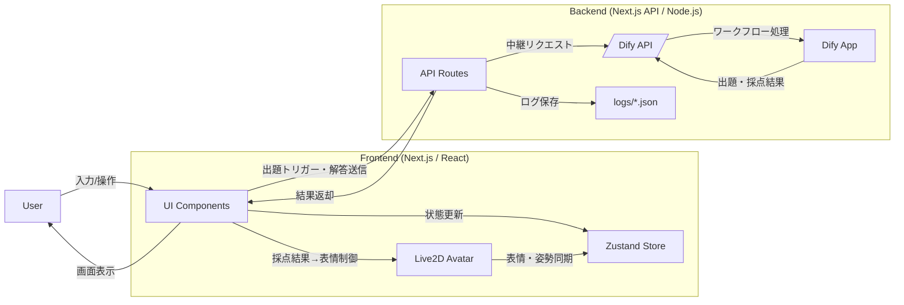

# System Architecture

## 構成の概要
aituberkit を使用して構築した本システムは、フロントエンドに React（アバターは Live2D）、バックエンドに Node.js（Next.js API）、LLM に Dify API を採用しています。フロントは UI とアバター表示、バックエンドは API 中継とログ保存、Dify はクイズ生成と採点ロジックを担当します。

## クイズ出題〜採点・表情変化の流れ
1) **出題**  
ユーザーの操作や起動時のトリガーでフロントから API を呼び出し、バックエンドが Dify API に問い合わせます。Dify 側のワークフローでクイズ（質問文・選択肢）を生成し、結果をバックエンド経由でフロントに返します。フロントは受け取ったデータを整形し、チャットログに表示します（選択肢はリスト表示）。

2) **解答送信**  
ユーザーが回答を入力すると、フロントがその内容をバックエンドへ送信します。バックエンドは Dify API に中継し、Dify 側で回答の正規化と正誤判定が行われます。

3) **採点結果の表示**  
Dify から返る採点結果（正解/不正解/判定不能と解説）をフロントが受け取り、HTML として UI に表示します。ログはバックエンドで保存され、回答内容・正誤・出題情報が履歴に残ります。

4) **表情変化**  
採点結果に応じてフロントが Live2D の表情制御を行います。正解なら Happy、不正解なら Sweat、選択肢外なら Rage といった表情を表示し、次の入力が送信されるまで維持されます。

## 図の流れ（番号付き）
1. 学習者が入力・操作 → UI が受け取る  
2. UI が API にリクエスト送信（出題トリガー/解答送信）  
3. API が Dify API に中継  
4. Dify App が出題/採点を生成して Dify API に返す  
5. API が結果を UI に返却  
6. UI が画面表示し、必要に応じて Live2D の表情を更新  
7. API がログを保存
